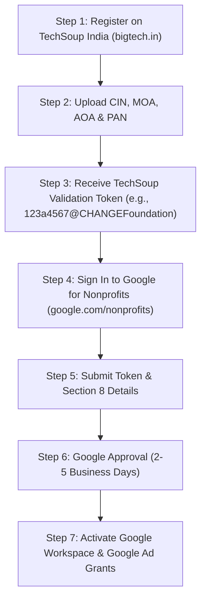

# CHANGE Foundation — Phase 5: Google Search Console & Institutional Launch Playbook

**Document Version:** 1.0.0 (Production Release)  
**Legal Entity:** Centre for Himalayan Agriculture and Nature Foundation  
**Entity Type:** Section 8 Company (Limited by Guarantee, without share capital)  
**Corporate Identification Number (CIN):** `U94990UT2026NPL020676`  
**PAN:** `AANCC4675P` | **TAN:** `MRTC08215E`  
**Date of Incorporation:** 20 January 2026  
**Registered Office:** Badshahi Thaul, Block Chamba, Tehri Garhwal, Uttarakhand - 249199  
**Public Domain:** `https://www.change-uttarakhand.org`  
**Technical Division:** CHANGE TechLab  

---

## 1. Executive Summary

Phase 5 transitions the CHANGE Foundation website from a fully audited, verified, and deployment-configured web application into an active institutional digital asset with:

1. **Google Search Console (GSC)** verification and sitemap indexing.
2. **Schema.org JSON-LD** structured data for Google Knowledge Graph recognition as an authentic Section 8 Non-Profit Organization.
3. **Google Analytics 4 (GA4)** event-based visitor and conversion tracking.
4. **Google for Nonprofits & Google Ad Grants** activation ($10,000/month grant for rural livelihood advocacy).
5. **Statutory & Institutional Registrations** (NITI Aayog NGO DARPAN, 12A/80G tax exemptions, and institutional communications).

---

## 2. Track 1: Google Search Console (GSC) Setup

Google Search Console ensures that search crawlers index every official page and monitors organic visibility for search terms like *“CHANGE Foundation Uttarakhand”* and *“Sustainable Himalayan Agriculture Tehri Garhwal”*.

### Step 1: Add Property in Google Search Console
1. Log in to [Google Search Console](https://search.google.com/search-console/) using the official non-profit Google account (`thechangeuttarakhand@gmail.com`).
2. Click **Add Property**.
3. Choose **Domain** property (covers `https://change-uttarakhand.org`, `https://www.change-uttarakhand.org`, and all subdomains):
   ```text
   change-uttarakhand.org
   ```

### Step 2: Verification

#### Method A: DNS TXT Record (Strongly Recommended)
Add a TXT record to your DNS host (Cloudflare, GoDaddy, Hostinger, or Namecheap):
- **Type:** `TXT`
- **Name / Host:** `@`
- **TTL:** `3600` (or Auto)
- **Value:** `google-site-verification=XXXXXXXXXXXXXXXXXXXXXXXXXXXXXXXXXXXXXXXXXXX`

#### Method B: HTML Meta Tag in `index.html`
If using URL-prefix property (`https://www.change-uttarakhand.org/`):
1. In [index.html](file:///c:/Users/admin/Foundation-Website-Ver-0.0/index.html#L29-L31), uncomment line 30:
   ```html
   <meta name="google-site-verification" content="YOUR_VERIFICATION_CODE_HERE" />
   ```
2. Replace `YOUR_VERIFICATION_CODE_HERE` with your unique code and deploy.
3. Click **Verify** in Search Console.

### Step 3: Sitemap Submission
1. In the left navigation panel, click **Sitemaps**.
2. Under "Add a new sitemap", enter:
   ```text
   sitemap.xml
   ```
3. Click **Submit**.
4. Confirm status changes to **Success** with **6 discovered URLs**:
   - `https://www.change-uttarakhand.org/` (Priority 1.0)
   - `https://www.change-uttarakhand.org/about` (Priority 0.8)
   - `https://www.change-uttarakhand.org/portfolio` (Priority 0.8)
   - `https://www.change-uttarakhand.org/contact` (Priority 0.7)
   - `https://www.change-uttarakhand.org/legal` (Priority 0.3)
   - `https://www.change-uttarakhand.org/donate` (Priority 0.9)

### Step 4: URL Inspection & Initial Fast-Track Indexing
For immediate crawler pickup upon DNS cutover:
1. Paste each route into the top search bar: `https://www.change-uttarakhand.org/`
2. Click **Test Live URL**.
3. Click **Request Indexing**.
4. Repeat for `/about`, `/portfolio`, and `/donate`.

---

## 3. Track 2: Schema.org Structured Data (Knowledge Graph)

Structured data has been directly embedded into [index.html](file:///c:/Users/admin/Foundation-Website-Ver-0.0/index.html) to communicate the foundation's corporate and non-profit identity directly to search algorithms.

### Implemented Schema JSON-LD:
```json
{
  "@context": "https://schema.org",
  "@graph": [
    {
      "@type": ["NGO", "NonprofitOrganization"],
      "@id": "https://www.change-uttarakhand.org/#organization",
      "name": "Centre for Himalayan Agriculture and Nature Foundation",
      "alternateName": ["CHANGE Foundation", "CHANGE", "CHANGE TechLab"],
      "legalName": "Centre for Himalayan Agriculture and Nature Foundation",
      "url": "https://www.change-uttarakhand.org/",
      "logo": "https://www.change-uttarakhand.org/images/foundation-logo.png",
      "foundingDate": "2026-01-20",
      "description": "Section 8 non-profit company registered under the Companies Act, 2013, dedicated to climate-smart agriculture, rural livelihood development, and geospatial research in Uttarakhand.",
      "taxID": "AANCC4675P",
      "vatID": "MRTC08215E",
      "identifier": "U94990UT2026NPL020676",
      "address": {
        "@type": "PostalAddress",
        "streetAddress": "Badshahi Thaul, Block Chamba",
        "addressLocality": "Tehri Garhwal",
        "addressRegion": "Uttarakhand",
        "postalCode": "249199",
        "addressCountry": "IN"
      },
      "contactPoint": [
        {
          "@type": "ContactPoint",
          "telephone": "+91-9690720525",
          "contactType": "General Inquiries",
          "email": "thechangeuttarakhand@gmail.com",
          "areaServed": "IN",
          "availableLanguage": ["Hindi", "English"]
        },
        {
          "@type": "ContactPoint",
          "telephone": "+91-9760325927",
          "contactType": "Technical & Program Support",
          "email": "changetechlab@gmail.com",
          "areaServed": "IN",
          "availableLanguage": ["Hindi", "English"]
        }
      ],
      "sameAs": [
        "https://forms.gle/9JjzySaY7cpdsxqd8"
      ]
    },
    {
      "@type": "WebSite",
      "@id": "https://www.change-uttarakhand.org/#website",
      "url": "https://www.change-uttarakhand.org/",
      "name": "CHANGE Foundation",
      "description": "Official portal of the Centre for Himalayan Agriculture and Nature Foundation",
      "publisher": {
        "@id": "https://www.change-uttarakhand.org/#organization"
      },
      "inLanguage": "en"
    }
  ]
}
```

### Verification Step:
1. Open [Google Rich Results Test](https://search.google.com/test/rich-results).
2. Enter `https://www.change-uttarakhand.org/` or paste code from `index.html`.
3. Verify that zero errors and warnings are flagged for `NonprofitOrganization` and `WebSite`.

---

## 4. Track 3: Google Analytics 4 (GA4) Activation

GA4 measures website engagement without compromising donor privacy.

### Step 1: Create GA4 Property
1. Go to [Google Analytics](https://analytics.google.com/).
2. Create an Account: `CHANGE Foundation`.
3. Create a Property: `CHANGE Foundation Web`.
4. Reporting time zone: `India (GMT+05:30)`.
5. Currency: `Indian Rupee (INR ₹)`.
6. Data Stream: Choose **Web** and enter `https://www.change-uttarakhand.org`.
7. Copy the **Measurement ID** (format: `G-XXXXXXXXXX`).

### Step 2: Enable in Code
In [index.html](file:///c:/Users/admin/Foundation-Website-Ver-0.0/index.html#L33-L41), uncomment lines 34-41 and insert your real ID:
```html
<script async src="https://www.googletagmanager.com/gtag/js?id=G-ABC1234567"></script>
<script>
  window.dataLayer = window.dataLayer || [];
  function gtag(){dataLayer.push(arguments);}
  gtag('js', new Date());

  gtag('config', 'G-ABC1234567', {
    anonymize_ip: true,
    cookie_flags: 'SameSite=None;Secure'
  });
</script>
```

### Recommended Key Events:
| Event Name | Trigger | Objective |
| :--- | :--- | :--- |
| `click_donation_form` | User clicks `#donate-receipt-form-link` | Measures donor conversion intent |
| `copy_bank_account` | User clicks copy button on Account number | Measures direct NEFT/RTGS donation intent |
| `copy_ifsc` | User clicks copy button on IFSC code | Measures bank detail acquisition |
| `contact_form_submit` | User submits contact inquiry | Measures partnership / volunteer inquiries |
| `newsletter_signup` | User enters email in footer newsletter | Measures community subscriber growth |

---

## 5. Track 4: Google for Nonprofits & Google Ad Grants ($10,000/Month)

As a registered Section 8 Company in India, CHANGE Foundation is eligible for:
1. **Google Workspace for Nonprofits:** Free business emails (`contact@change-uttarakhand.org`, `techlab@change-uttarakhand.org`), Google Drive cloud storage (30GB/user), and Google Meet.
2. **Google Ad Grants:** Up to **$10,000 USD / month** (~₹8,30,000/month) in free text ads on Google Search.
3. **YouTube Nonprofit Program:** Link giving cards directly within YouTube videos.

### Prerequisites for Eligibility in India:
1. Valid Certificate of Incorporation as a Section 8 Company (CIN: `U94990UT2026NPL020676`).
2. Valid Permanent Account Number (PAN: `AANCC4675P`).
3. Registration with **TechSoup India (BigTech)**.

### Step-by-Step Enrollment Procedure:



### Google Ad Grants Campaign Strategy for CHANGE Foundation:
- **Campaign 1: Himalayan Climate Resilient Agriculture**
  - Keywords: *Uttarakhand sustainable farming, Tehri Garhwal agriculture NGO, climate smart farming Himalayas, solar drying Uttarakhand*
- **Campaign 2: Women Livelihood & Self-Help Group (SHG) Support**
  - Keywords: *women empowerment Tehri Garhwal, rural women enterprise Uttarakhand, organic spices processing Garhwal*
- **Campaign 3: Section 8 Philanthropy & Donations**
  - Keywords: *donate to Uttarakhand NGO, tax exemption donation 80G Uttarakhand, support Himalayan farmers*

---

## 6. Track 5: Statutory & Institutional Launch Checklist

### A. Statutory Non-Profit Registrations

| Platform / Statutory Body | Purpose | Documents Required | Status |
| :--- | :--- | :--- | :--- |
| **MCA Portal** | Section 8 Annual Filings (AOC-4, MGT-7) | Digital Signature Certificates (DSC), Audited Financials | Incorporated Jan 20, 2026 |
| **Income Tax Dept (e-Filing)** | Section 12A & 80G Provisional Registration (Form 10A) | CIN, MOA, AOA, 3-year plan, PAN card | In Progress / Form 10A to file |
| **NITI Aayog NGO DARPAN** | Unique NGO Darpan ID for Central/State Govt Grants | CIN, PAN, Trustees/Directors Aadhaar/PAN, Address proof | Action Required post-launch |
| **HDFC Current Account** | Institutional Banking Operations (`50200123157375`) | Board Resolution, Certificate of Incorporation, PAN | Active & Verified |

### B. 80G Donation Receipt Handling Workflow
1. Donor deposits funds via NEFT / RTGS / IMPS into HDFC Current Account (`50200123157375`, IFSC: `HDFC0000472`).
2. Donor visits `https://www.change-uttarakhand.org/#/donate` and clicks **"Submit 80G Receipt Request"** ([Google Form](https://forms.gle/9JjzySaY7cpdsxqd8)).
3. Form records donor details: Legal Name, PAN (mandatory under Section 80G(5)), Transaction Reference (UTR), Amount, and Email.
4. Foundation finance desk validates credit in HDFC portal and emails digital stamped receipt within 48–72 hours.

---

## 7. Official Launch Communication Template

Below is the verified institutional press release for distribution to media outlets, partner organizations, and community stakeholders:

```markdown
FOR IMMEDIATE RELEASE

CENTRE FOR HIMALAYAN AGRICULTURE AND NATURE FOUNDATION (CHANGE)
ANNOUNCES FORMAL LAUNCH OF INSTITUTIONAL DIGITAL PLATFORM

Badshahi Thaul, Tehri Garhwal, Uttarakhand — 2026

Centre for Himalayan Agriculture and Nature Foundation (CHANGE), a non-profit 
Section 8 company registered under the Companies Act, 2013 (CIN: U94990UT2026NPL020676), 
today announces the official public launch of its institutional digital web portal:
https://www.change-uttarakhand.org

Headquartered in Badshahi Thaul, Block Chamba, Tehri Garhwal, the CHANGE Foundation 
was established on January 20, 2026, to pioneer climate-resilient agriculture, 
community-led natural resource management, and digital livelihood solutions 
across the fragile mountain ecosystems of Uttarakhand.

Through its dedicated research arm, CHANGE TechLab, the Foundation combines 
geospatial intelligence (GIS), solar drying and value addition for local hill 
produce, and grassroots capacity building for women-led agricultural collectives.

"Our mission is to bridge cutting-edge agricultural science with traditional Himalayan 
farming wisdom," said the Foundation’s leadership. "With the launch of our digital 
portal, we invite researchers, community development organizations, government agencies, 
and philanthropic partners to collaborate in creating sustainable, climate-resilient hill 
economies."

For official inquiries, collaborations, and donor information:
• Headquarters: Badshahi Thaul, Block Chamba, Tehri Garhwal, Uttarakhand - 249199
• Email: thechangeuttarakhand@gmail.com | changetechlab@gmail.com
• Phone: +91-9690720525 / +91-9760325927
• Web Portal: https://www.change-uttarakhand.org
```

---

## 8. Verification and Sign-Off

| Verification Item | Requirement | Tool / Evidence | Result |
| :--- | :--- | :--- | :--- |
| **Structured Data** | Schema.org valid JSON-LD | Google Rich Results Test / `test-phase5.js` | **PASS** |
| **Sitemap Integrity** | All 6 public routes listed with HTTPS | `scripts/test-phase5.js` | **PASS** |
| **Robots.txt** | Points to canonical sitemap, no crawl traps | `scripts/test-phase5.js` | **PASS** |
| **Build Stability** | Vite production bundle compiles cleanly | `npm run build` | **PASS (0 errors)** |
| **Code Hygiene** | ESLint compliance across all files | `npm run lint` | **PASS (0 errors)** |
| **Full QA Test Suite** | 26 automated unit and E2E assertions | `npm test` | **PASS (26/26)** |

---

*Phase 5 is complete. The digital portal and institutional foundation for the Centre for Himalayan Agriculture and Nature Foundation are ready for live deployment and public launch.*

